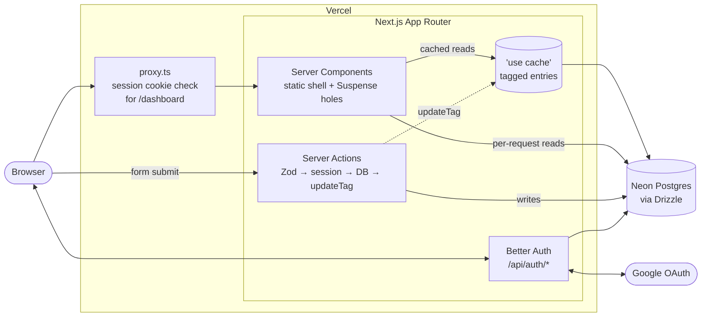
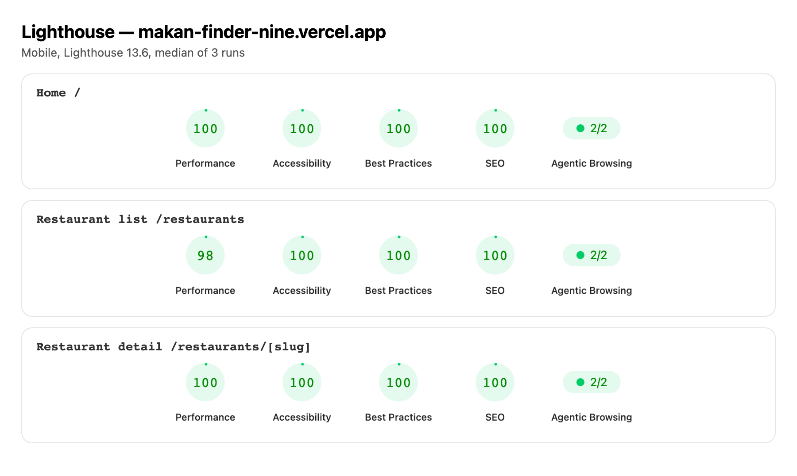

# Makan Finder 🍜

A Malaysian food directory: browse restaurants by state, cuisine, price and halal status, see what's open right now, and sign in with Google to review and save your favourites.

**Live demo:** https://makan-finder-nine.vercel.app

[](https://github.com/imping26/makan-finder/actions/workflows/ci.yml)

Next.js 16 (App Router, Cache Components) · React 19 · TypeScript · Tailwind CSS v4 · Drizzle ORM · PostgreSQL (Neon) · Better Auth · Vitest · Playwright

> All restaurants, addresses and reviews in the demo are fictional seed data.

## Features

- **Browse and filter**: state, cuisine, price, halal and name search, with pagination. All filter state lives in the URL, so every result page is shareable and works with the back button.
- **Restaurant pages**: details, opening hours, an "Open now / Closed" badge computed in Malaysia time, reviews, per-page metadata and a generated Open Graph image.
- **Google sign-in**: Better Auth with sessions stored in Postgres.
- **Reviews**: write, edit and delete your own review. The restaurant's average rating is recalculated in the same transaction.
- **Favourites**: an optimistic save button that updates instantly and rolls back on failure.
- **Dashboard**: your favourites and reviews, behind a protected route.
- **SEO**: sitemap, robots.txt, canonical URLs and Open Graph images.

## Architecture



**Conventions the code follows:**

- **Reads** live in `src/lib/queries/*` (`server-only`).
- **Writes** are Server Actions in `src/lib/actions/*`, always in the same order: validate with Zod → check the session → write in a transaction → invalidate cache tags.
- **Components** are Server Components by default. `"use client"` appears only on interactive leaves (forms, the favourite button, sign-in/out).

## Rendering strategy

With Cache Components, rendering is decided per component rather than per route. Every page is partially prerendered: a static shell is built ahead of time, and anything that needs the request streams into `<Suspense>` holes.

| Route                 | Static shell (prerendered, revalidated)                                            | Streamed per request                                              | Why                                                                                              |
| --------------------- | ---------------------------------------------------------------------------------- | ----------------------------------------------------------------- | ------------------------------------------------------------------------------------------------ |
| `/`                   | Hero, top rated (`cacheLife("hours")`), state/cuisine links                        | Header user menu                                                  | Same for everyone and changes slowly                                                             |
| `/restaurants`        | Page frame                                                                         | Filter bar and results (read `searchParams`)                      | Results depend on the URL; each filter combination is cached separately                          |
| `/restaurants/[slug]` | Name, description, address, opening hours (`generateStaticParams` + `"use cache"`) | Open/closed badge, rating, reviews, review form, favourite button | Details rarely change; reviews and ratings change often and must never be stale                  |
| `/dashboard`          | Page frame                                                                         | Everything below the heading                                      | Per user. Protected optimistically by `proxy.ts`, then verified against the database in the page |

### Caching and invalidation

| Cached read                 | Tags                            | Invalidated by                |
| --------------------------- | ------------------------------- | ----------------------------- |
| `getRestaurants(filters)`   | `restaurants`                   | `saveReview`, `deleteReview`  |
| `getPopularRestaurants()`   | `restaurants`                   | `saveReview`, `deleteReview`  |
| `getRestaurantBySlug(slug)` | `restaurant:<slug>`             | `saveReview`, `deleteReview`  |
| `getFavoritesByUserId(id)`  | `favorites:<id>`, `restaurants` | `setFavorite`, review actions |
| `getReviewsByUserId(id)`    | `reviews:<id>`                  | `saveReview`, `deleteReview`  |

Per-user caches are keyed by user id through an unexported inner function, so no caller can request another user's data. Data that is personal _and_ cheap (`getMyReview`, `getIsFavorited`) is not cached at all.

## Data model

`restaurants`, `reviews`, `favorites`, `photos`, plus Better Auth's `user`, `session`, `account` and `verification` tables.

| Decision                                                | Why                                                                                                                                                    |
| ------------------------------------------------------- | ------------------------------------------------------------------------------------------------------------------------------------------------------ |
| `avg_rating` and `review_count` stored on `restaurants` | Listing and sorting by rating needs no join or aggregate. They're recalculated inside the same transaction as every review write, so they can't drift. |
| Unique `(restaurant_id, user_id)` on reviews            | One review per user per restaurant, enforced by the database. Saving is an upsert (`ON CONFLICT DO UPDATE`).                                           |
| Composite primary key on favorites                      | A favourite is just the pair. Saving uses `ON CONFLICT DO NOTHING`, so repeated clicks are harmless.                                                   |
| Unique `slug`                                           | Readable, stable URLs. Slugs are generated by a tested `slugify`.                                                                                      |
| Postgres enums for state and cuisine                    | Invalid values are rejected by the database. The same lists drive the filter UI and the Zod schemas.                                                   |
| `status` on restaurants                                 | Room for user submissions with moderation. Every public query filters to `approved`.                                                                   |

## Problems worth mentioning

- **A stale page that lasted up to an hour.** An E2E test on CI occasionally saw an old review after a quick edit. Tracing it into Next's source showed that `"use cache"` entries are timestamped when computation _starts_, but the prerendered route shell is timestamped when it's _stored_. A shell regeneration that read the database before a write, but finished after `updateTag`, was treated as fresh. The fix was architectural: frequently changing, user-generated data (ratings, reviews) now renders per request, while the stable details stay in the static shell. React `cache()` dedupes the shared query within a request.
- **Signing in during E2E tests without Google.** A test-only Better Auth instance with the `testUtils` plugin creates a real session in the test database and hands the signed cookie to Playwright. The app's auth config is untouched. Tests refuse to run against any database that isn't on localhost.
- **A third-party library calling `new Date()` during prerendering.** Better Auth checks session expiry with the current time, which Cache Components rejects while prerendering. Reading the session now starts with `await connection()`, so it always runs at request time.
- **Opening hours in the right time zone.** Servers run in UTC. The `isOpenAt` logic converts to Malaysia time (UTC+8, no daylight saving) and handles overnight hours (18:00–02:00), closed days and 24-hour places. Covered by unit tests.
- **Layout shift from streaming.** After moving reviews to per-request streaming, opening hours jumped on phones. It was diagnosed by recording `layout-shift` entries under throttling, and fixed by ordering and sizing skeletons to match the real content.

## Testing and CI

- **Unit tests (Vitest, 32 tests):** pure functions only, with a focus on edge cases and hostile input: opening hours, `slugify`, URL filter parsing and review validation.
- **End-to-end tests (Playwright):**
  - Signed-out browsing, filtering, the dashboard redirect and the 404 page.
  - Signed in: write → reload → edit → see it on the dashboard → delete; save and unsave a favourite.
  - Runs against a production build with its own Postgres database.
- **GitHub Actions** runs on every push and pull request: typecheck, lint, Prettier, unit tests, migrate + seed a throwaway Postgres service, production build, then the E2E suite.

## Lighthouse

Mobile, median of 3 runs on the live site:



## Getting started

Requires Node.js 22 and a PostgreSQL database: [Neon](https://neon.tech) or Supabase (both free), or local Docker (`docker compose up -d`).

```bash
npm install
cp .env.example .env.local   # then fill in the values below
npm run db:migrate           # create tables from drizzle/
npm run db:seed              # 36 fictional restaurants, 6 users, ~118 reviews
npm run dev                  # http://localhost:3000
```

| Variable                                    | Notes                                                                                              |
| ------------------------------------------- | -------------------------------------------------------------------------------------------------- |
| `DATABASE_URL`                              | Pooled connection string                                                                           |
| `DATABASE_URL_UNPOOLED`                     | Direct connection, used by migrations and the seed script (optional; falls back to `DATABASE_URL`) |
| `NEXT_PUBLIC_SITE_URL`                      | Public URL, used for metadata and the sitemap                                                      |
| `BETTER_AUTH_SECRET`                        | `openssl rand -base64 32`                                                                          |
| `BETTER_AUTH_URL`                           | `http://localhost:3000` locally                                                                    |
| `GOOGLE_CLIENT_ID` / `GOOGLE_CLIENT_SECRET` | Google Cloud OAuth client; redirect URI `<site>/api/auth/callback/google`                          |

### Scripts

| Command                              | Does                                                                                                                                                        |
| ------------------------------------ | ----------------------------------------------------------------------------------------------------------------------------------------------------------- |
| `npm run dev` / `build` / `start`    | Develop, build, serve the production build                                                                                                                  |
| `npm run typecheck`                  | Generate route types, then `tsc`                                                                                                                            |
| `npm run lint` / `format`            | ESLint / Prettier                                                                                                                                           |
| `npm test`                           | Vitest unit tests                                                                                                                                           |
| `npm run test:e2e`                   | Playwright. Creates and seeds a local `makan_finder_e2e` database, builds, and tests on port 3100. Set `E2E_DATABASE_URL` to use a different local database |
| `npm run db:generate` / `db:migrate` | Create / apply migrations after a schema change                                                                                                             |
| `npm run db:seed`                    | Reset the demo data                                                                                                                                         |
| `npm run db:studio`                  | Browse the database in Drizzle Studio                                                                                                                       |

## Project structure

```
src/
  app/                  routes: /, /restaurants, /restaurants/[slug], /dashboard, /sign-in, /api/auth
  components/           auth, layout, restaurants, dashboard, ui (shadcn/ui)
  lib/
    actions/            Server Actions (writes)
    queries/            cached and per-request reads
    validations/        Zod schemas
    db/                 Drizzle schema and client
    auth.ts, session.ts Better Auth config and the session helper
    opening-hours.ts    "Open now" logic
  proxy.ts              optimistic route protection
e2e/                    Playwright tests and the test-only auth setup
scripts/                seed and E2E database preparation
drizzle/                generated SQL migrations
```

## Roadmap

- Natural-language search ("cheap halal breakfast in PJ" → structured filters)
- User-submitted restaurants with an admin approval queue
- Photo uploads
- Map view
